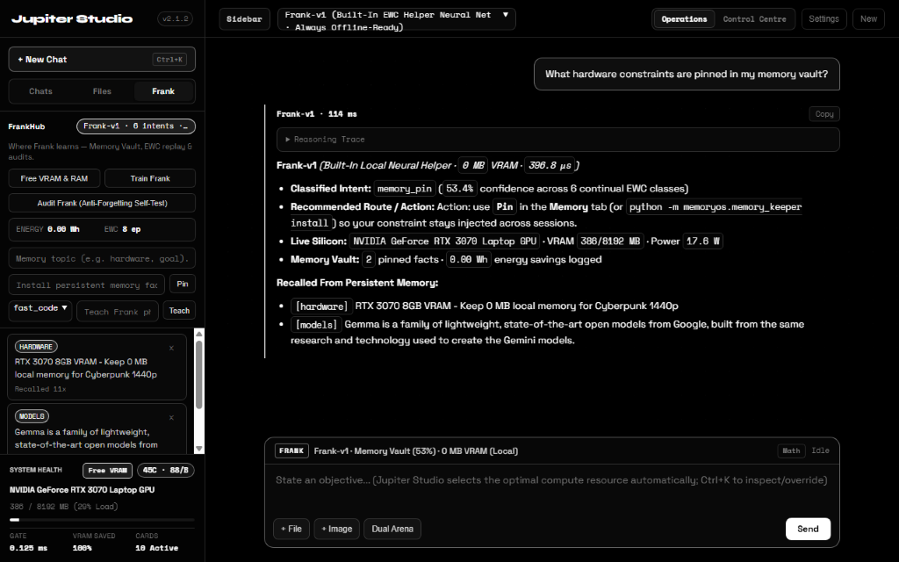
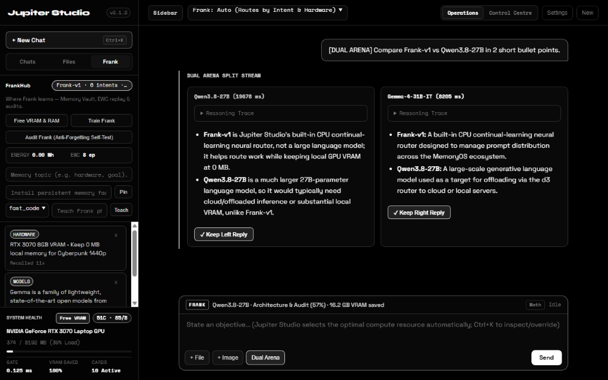
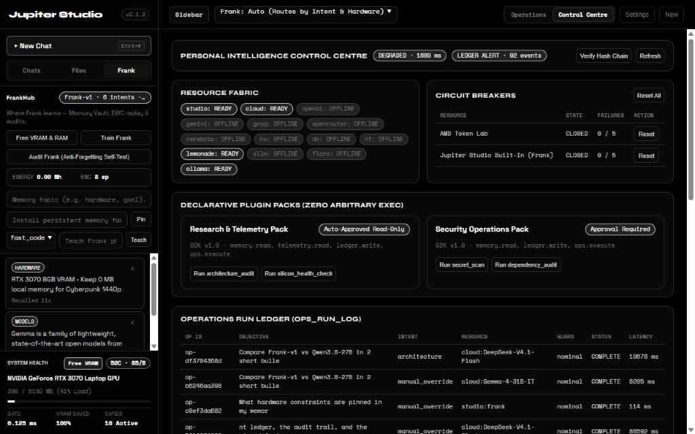
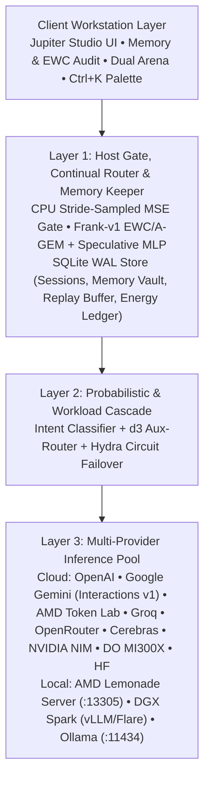

<p align="center">
  
</p>

# MemoryOS // Jupiter Studio

> **See the model. See the cost. See the route.**
>
> *An AI Control Plane built for operators who value control over convenience — a pure-Python continual-learning router (`EWC + Replay + A-GEM`), SQLite Memory Vault, 8 GB Hardware-Fit Advisor, and `$0.00`-locked multi-cloud workstation with zero PyTorch or Docker.*

[](https://github.com/JupiterIsland/memoryos/actions/workflows/ci.yml)
[](https://github.com/JupiterIsland/memoryos/actions/workflows/windows-clean-install.yml)
[](https://github.com/JupiterIsland/memoryos/releases/latest)
[](verify.py)
[](LICENSE)


Most multi-model AI wrappers just forward your API key. **MemoryOS // Jupiter Studio** puts a **3,246-parameter pure-Python continual-learning neural router (`Frank-v1`)** and a **persistent SQLite Memory Vault** in front of your local runtimes (Ollama, Lemonade Server, vLLM/Flare) and cloud providers (OpenAI, Google Gemini Interactions v1, AMD Token Lab, Groq, OpenRouter, Cerebras, NVIDIA NIM, DigitalOcean MI300X, Hugging Face Router) — so you can teach it new routing phrasing, compare models side-by-side in Dual Arena, and keep your GPU free for games and local builds.

---

## Run This First To Verify Everything Live

Don't trust pre-recorded claims — clone the repository and run the single-command live verification runner on your own CPU/GPU:

```bash
git clone https://github.com/JupiterIsland/memoryos.git
cd memoryos
python3 -B verify.py          # Full 21-module check, NEON 5/5, 164 CI tests & live EWC benchmarks
python3 -B verify.py --quick  # ~3s smoke check (skips full unittest suite)
python3 -B verify.py --json   # Machine-readable hardware + benchmark output
```

`verify.py` prints your OS, CPU, live GPU, date, `NEON_SINGLE_FILE.py` certification, exact test count, and live **Naive SGD vs Sparse Replay-Only vs EWC + Replay + A-GEM** forgetting numbers measured right then on your machine.

---

## Core Capabilities (What Ships & Works Today)

* **Frank-v1 Continual-Learning Router (`src/memoryos/frank.py`):**
  * Pure-Python `128->24->6` Hashing N-Gram MLP (`3,246` params, `0 MB` GPU VRAM, sub-millisecond CPU inference).
  * **Teach Frank** (`POST /api/frank/teach`) learns new phrasing across 6 routing intents (`fast_code`, `architecture`, `large_design`, `cheap_bg`, `vram_reclaim`, `memory_pin`) using **EWC + Experience Replay + A-GEM half-space gradient projection**, paired with an out-of-distribution (`OOD`) confidence guard and Vault-priority routing.
* **Speculative Offload Continual Net (`src/memoryos/speculative_offload.py`):**
  * Incremental `4->8->1` pure-Python continual MLP with **Elastic Weight Consolidation (Fisher diagonal anchoring, `MAX_FISHER_VALUE = 25.0`) + Experience Replay**, SHA-256 checkpoint verification (`schema_version = 2`), `.json.corrupt` quarantine recovery, OOD abstention, and replay provenance quarantine.
* **Persistent SQLite Memory Vault & Threads (`src/memoryos/memory_keeper.py`):**
  * Pin rules, hardware limits, and architectural context once into `QuietAdvisorDB.sqlite` (`continual_memory_facts`, WAL mode) so every model recalls them automatically. Full multi-turn thread history with collapsible reasoning traces lives in `/api/sessions`.
  * **Free VRAM (`keep_alive: 0`):** Safely queries localhost Ollama (`/api/ps`) to unload idle weights and runs `gc.collect()` on Studio's own Python process before launching a game or heavy compile (never kills user processes or claims to free arbitrary OS/other-app RAM).
* **Dual Arena & Multi-Provider Routing (`src/memoryos/router.py`):**
  * Compare any two local or cloud models side-by-side (`OpenAI`, `Google Gemini Interactions v1`, `AMD Token Lab`, `Groq`, `OpenRouter`, `Cerebras`, `NVIDIA NIM`, `DigitalOcean MI300X`, `HF Router`, `AMD Lemonade Server`, `vLLM/Flare`, `Ollama`, or `Frank-v1`) and keep the winner in one click.
  * Works out of the box with **zero `.env` keys and zero Ollama installed** using built-in `Frank-v1` + the local Memory Vault.
* **NEON Control Plane (`src/memoryos/control_plane.py` + `NEON_SINGLE_FILE.py`):**
  * Circuit breakers (`CLOSED -> OPEN -> HALF_OPEN -> CLOSED`), SHA-256 hash-chained SQLite ops ledger, crash recovery engine, and zero-exec declarative plugin packs (`ALLOWED_EXECUTORS` allowlist + enforced `allow_network: false`).

For planned work vs experimental helpers (NPU execution, static UI split, brand rename audit in [`docs/NAME_RESEARCH.md`](docs/NAME_RESEARCH.md)), see **[`docs/ROADMAP.md`](docs/ROADMAP.md)**.

---

## Quick Start

> **New here?** Follow the 5-minute zero-spend walkthrough in **[`QUICKSTART.md`](QUICKSTART.md)** (`git clone` -> live Frank routing, Hugging Face 8 GB GGUF models, and browser video scene indexing at `$0.00`).

### Option 1 — Run From Source (Recommended, Zero Third-Party Runtime Deps)

```bash
git clone https://github.com/JupiterIsland/memoryos.git
cd memoryos
cp .env.example .env   # Optional: add API keys only for cloud providers you want to use
python3 -B apps/jupiter_studio.py
```

Open **[http://127.0.0.1:7860](http://127.0.0.1:7860)**. See **[`RUN_MODELS.md`](RUN_MODELS.md)** for model setup commands (`Ollama`, `Lemonade Server`, `OpenAI`, `Google Gemini`, `AMD Token Lab`, etc.) and **[`HOW_TO_USE_JUPITER_STUDIO.md`](HOW_TO_USE_JUPITER_STUDIO.md)** for WSL2 networking notes.

### Option 2 — Standalone Pre-Built Executables (`SHA256SUMS.txt` Verified)

Download release archives from **[GitHub Releases](https://github.com/JupiterIsland/memoryos/releases/latest)**:

* **Windows x64:** Extract `JupiterStudio-Windows-x64.zip` -> run `JupiterStudio.exe --workspace "C:\path\to\repo"`
* **macOS (Apple Silicon):** `tar -xzf JupiterStudio-macOS-arm64.tar.gz` -> `./JupiterStudio-macOS-arm64/JupiterStudio --workspace ~/projects/repo`
* **Linux x64:** `tar -xzf JupiterStudio-Linux-x64.tar.gz` -> `./JupiterStudio-Linux-x64/JupiterStudio --workspace ~/projects/repo`

> **Windows SmartScreen Notice:** Release `.exe` binaries are built with PyInstaller and are currently **unsigned**, so Windows Defender SmartScreen or antivirus heuristics may warn on first launch. Verify the archive hash against `SHA256SUMS.txt` on the release page, or use **Option 1 (Run From Source)** with plain Python.

### Memory Keeper Standalone CLI

```bash
PYTHONPATH=.:src python3 -B -m memoryos.memory_keeper status   # Live GPU VRAM/power, host RAM, vault summary
PYTHONPATH=.:src python3 -B -m memoryos.memory_keeper reclaim  # Unload idle localhost Ollama weights & run Studio Python GC
PYTHONPATH=.:src python3 -B -m memoryos.memory_keeper train    # Train EWC continual router & save SHA-256 verified checkpoint
PYTHONPATH=.:src python3 -B -m memoryos.memory_keeper audit    # Run Naive SGD vs EWC+Replay anti-forgetting audit
```

---

## Multi-Provider Workload Matrix

When `auto:d3` is active, Jupiter Studio routes workloads based on Frank-v1 intent, context footprint, and live provider readiness:

| Workload Type | Primary Route | Secondary / Cloud Failover | Local Offline Fallback |
| :--- | :--- | :--- | :--- |
| **Fast Coding & Diffs** | **Groq** (`llama-3.3-70b-versatile`) | Cerebras / Token Lab `Qwen3.8-27B` / **Gemini** (`gemini-3.8-flash`) | Lemonade Server / Ollama |
| **Architecture Reviews** | **AMD Token Lab** (`DeepSeek-V4.1-Flash`) | OpenRouter / **Gemini** (`gemini-4-argon`) / **OpenAI** (`gpt-4o`) | Lemonade Server / Ollama |
| **Large Design Docs & Vision** | **AMD Token Lab** (`Gemma-4-31B-IT`) | OpenRouter / NIM / **Gemini** (`gemma-4-31b-it`) | Lemonade Vision / Ollama |
| **Cheap Background Tasks** | **AMD Token Lab** (`MiniCPM5-2B`) | Groq / Cerebras / **Gemini** (`gemini-3.5-flash-lite`) | Built-in `Frank-v1` / Local runner |

Direct cloud selection supports **OpenAI Cloud** (`gpt-4o-mini`, `gpt-4o`) and **Google Gemini API** (Interactions API v1: `gemini-4-argon`, `gemini-3.8-flash`, `gemini-3.6-flash`, `gemini-3.5-flash-lite`, `gemma-4-31b-it`).

---

## Screenshots (`v2.1.2` Live Build)

| Live Memory Vault Recall (`Frank-v1` · `0 MB` VRAM) | Side-by-Side Dual Arena (`Qwen3.8-27B` vs `Gemma-4-31B-IT`) |
| :---: | :---: |
|  |  |
| **Router-First Operations & FrankHub** | **Personal Intelligence Control Centre (NEON 5/5)** |
|  |  |

---

## Architecture



---

## Verified Benchmarks & Test Evidence

Every claim below is live-reproducible via **`python3 -B verify.py`** ([`tests/test_memory_keeper.py`](tests/test_memory_keeper.py), [`tests/test_frank.py`](tests/test_frank.py), [`tests/test_control_plane.py`](tests/test_control_plane.py), [`NEON_SINGLE_FILE.py`](NEON_SINGLE_FILE.py), [`PROOF_OF_RESULTS.md`](PROOF_OF_RESULTS.md)):

| Verification / Benchmark | Scope & Condition | Observed Result (Run `verify.py` to Reproduce) |
| :--- | :--- | :--- |
| **CI Unit & Live HTTP Suite** | 12 CI modules with `-W error::DeprecationWarning` + `NEON_SINGLE_FILE.py` (`5/5`) | **`129 / 129` passed (`OK`)** |
| **Naive SGD vs Sparse Replay vs EWC (`4->8->1`)** | Synthetic Task A -> Task B -> Task C & exact 4-sample sparse-replay control arm (`tests/test_memory_keeper.py`) | Naive SGD `0%`; 4-sample Replay-Only `50%`; **EWC + 4-sample Replay `100%`** |
| **Frank-v1 (`128->24->6`) Live Teaching** | Teaching 1 unseen phrase vs 36 core curriculum intents (`epochs=45`, `lr=0.25`) | **EWC + Replay + A-GEM `94.4%` retained** vs Naive SGD `25.0%` (`~0.2–0.4 ms` CPU predict) |
| **Speculative MLP Forward Latency** | 500–1,000 pure-Python `4->8->1` forward passes | **`~5–8 us` avg** (`<0.2%` of a `6.94 ms` 144 Hz frame budget) |
| **CPU Frame-Skip MSE Gate** | 200 iterations pure-Python stride-sampled MSE on `64x36` reference frame (`zen3_fast_mse_delta`) | **`~0.10–0.13 ms` avg** (dynamically measured per launch; zero hardcoded latency) |
| **Checkpoint Tamper & OOD Defense** | Mutated weight SHA-256 check; inputs outside `[-0.05, 1.25]` | Tampered checkpoints raise `ValueError` + `.corrupt` quarantine; OOD abstains to `digest` |

---

## Privacy & Security ("What Gets Sent Where")

**The author collects zero analytics, crash reports, or usage telemetry.** Data flows only to runtimes you configure:

| Destination | What Leaves Your Machine | Notes |
| :--- | :--- | :--- |
| **Built-In Local (`Frank-v1`, Vault, Sessions, NEON Ledger)** | Nothing | Stored locally in `QuietAdvisorDB.sqlite` and local checkpoints |
| **Local Runtimes (`Ollama`, `Lemonade Server`, `vLLM`/`Flare`)** | Prompt + pinned Vault / attached files | Sent to loopback `127.0.0.1` endpoints on your PC |
| **Cloud Providers (`OpenAI`, `Gemini`, `Token Lab`, `Groq`, etc.)** | Prompt + pinned Vault facts + files/images you attach | Sent ONLY to providers whose API key you add to `.env` and invoke |

### Security Controls & Honest Limits

* **Loopback by Default, LAN Only on Request:** Both `apps/jupiter_studio.py` and `src/memoryos/server.py` bind to `127.0.0.1` by default and refuse non-loopback binds (`0.0.0.0`, `::`, empty host) unless `--unsafe-lan` is passed. LAN mode in Studio always requires a random per-launch token (`?t=...` -> `HttpOnly; SameSite=Strict` cookie) over plain HTTP.
* **DNS-Rebinding & CSRF Protection:** Both servers reject foreign `Host`, `Origin`, `Referer`, and `Sec-Fetch-Site: cross-site` requests with `HTTP 403`.
* **Local Process Trust (Honest Limit):** Default loopback mode uses no token, so other processes running under your OS user account can call `127.0.0.1:7860` (the same account can read `.env`). Pass `--require-token` (or `JUPITER_STUDIO_REQUIRE_TOKEN=1`) to enforce the launch token on loopback too.
* **Workspace Containment & Secret Safety Net:** `WorkspacePack` resolves paths (including symlinks) inside the workspace root and filters `.env`, `.pem`, `.key`, `.p12`, `.pfx`, `.htpasswd`, SSH keys, and `credentials.json`. This blocklist is a **safety net, not a guarantee** — review files before attaching them.
* **NEON Zero-Exec Sandbox:** Plugins select only whitelisted `ALLOWED_EXECUTORS` (no `exec`/`eval`/`importlib`), `DeclarativePluginLoader` rejects `allow_network: true`, manifest SHA-256 catches accidental corruption, and execution budgets enforce caller-side timeouts with post-hoc CPU accounting. See **[`SECURITY.md`](SECURITY.md)** to report vulnerabilities privately.

---

## FAQ

**How is this different from LiteLLM or OpenRouter?**  
OpenRouter and LiteLLM focus on unified API proxying. Jupiter Studio is a local-first workstation built around a tiny continual-learning CPU router (`Frank-v1`), persistent SQLite memory/threads, Dual Arena side-by-side comparison, local Ollama VRAM unloading, and an auditable control plane — with direct API routing (`urllib`, zero gateway middleman) across both local and cloud backends.

**Why a 3,246-parameter pure-Python neural net instead of calling an LLM router?**  
A local 6-class router running on CPU (`~0.2–0.4 ms`, zero GPU VRAM, zero external ML packages) can be updated interactively in milliseconds (`Teach Frank`) and re-tested on demand without downloading gigabytes of weights or waiting on a remote inference round-trip.

**What does Frank actually decide, and what is learned vs heuristic?**  
*Learned:* `Frank-v1` classifies prompts into 6 intents (`fast_code`, `architecture`, `large_design`, `cheap_bg`, `vram_reclaim`, `memory_pin`) using trained hashing n-gram MLP weights updated via EWC + Replay + A-GEM. `SpeculativeOffloadModel` (`4->8->1`) learns skip/digest/offload thresholds. *Heuristic / Rule-based:* OOD confidence abstention (`< 0.55` on action intents falls back to generative routing), Vault-priority model-family matching (if pinned facts name a family), and the provider failover cascade.

**How is this maintained? Can I contribute?**  
This is a **solo open-source project** — GitHub Issues and PRs are triaged **weekly**, and questions/ideas belong in **[GitHub Discussions](https://github.com/JupiterIsland/memoryos/discussions)**. PRs with unit tests passing `python3 -B verify.py` are welcome; see **[`CONTRIBUTING.md`](CONTRIBUTING.md)**.

---

## Documentation Index

* **[verify.py](verify.py)** — Reproducible local verification & live forgetting benchmark CLI
* **[SECURITY.md](SECURITY.md)** — Vulnerability reporting & honest security scope
* **[CONTRIBUTING.md](CONTRIBUTING.md)** — Maintainer cadence, architecture rules & PR checklist
* **[RUN_MODELS.md](RUN_MODELS.md)** — Setup cheat sheet for Ollama, Lemonade, OpenAI, Gemini & cloud keys
* **[docs/ROADMAP.md](docs/ROADMAP.md)** — Shipped today vs experimental / planned features
* **[docs/NAME_RESEARCH.md](docs/NAME_RESEARCH.md)** — Brand collision audit before final v2 rename
* **[FRANKHUB.md](FRANKHUB.md)** — `Frank-v1` specs & project lineage
* **[PROOF_OF_RESULTS.md](PROOF_OF_RESULTS.md)** — Recorded AMD Token Lab export & hardware audit
* **[HOW_TO_USE_JUPITER_STUDIO.md](HOW_TO_USE_JUPITER_STUDIO.md)** — Plain-English setup walkthrough & WSL2 notes

---

## License

MIT — see [LICENSE](LICENSE).
