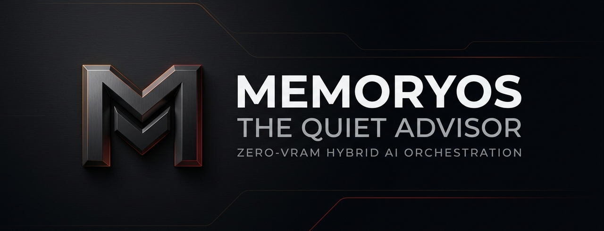
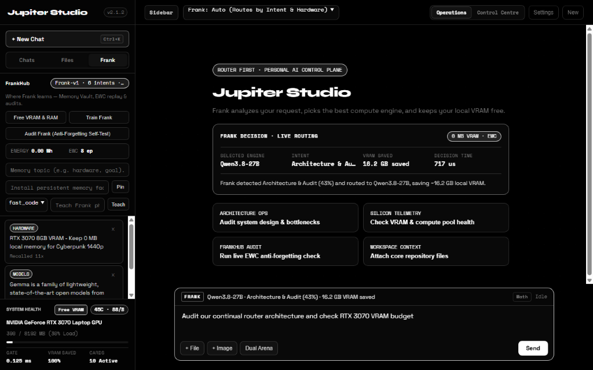
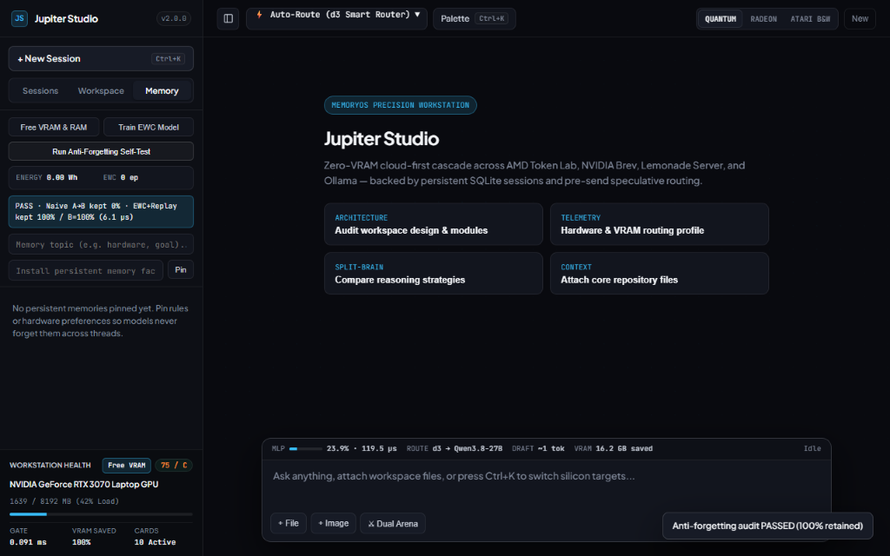
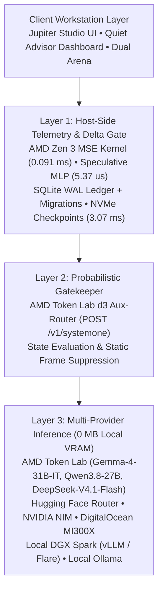

# MemoryOS // The Quiet Advisor

### Hardware-Aware AI Workload Orchestration, Zero-VRAM Cloud Offloading, and Speculative Host-Side Gating



[](https://github.com/JupiterIsland/memoryos/releases/latest)
[](https://github.com/JupiterIsland/memoryos/actions/workflows/ci.yml)
[](https://github.com/JupiterIsland/memoryos/releases/latest)
[](PROOF_OF_RESULTS.md)
[](ARCHITECTURE.md)

MemoryOS is a hardware-aware local AI workstation and orchestration layer built for laptops and desktops where GPU VRAM is tight. It pairs host-side CPU gating (`0.091 ms` AMD Zen 3 SIMD gate + `5.37 μs` pure-Python Speculative Offload MLP) with zero-VRAM cloud and LAN routing across **AMD Token Lab**, **Hugging Face Inference Router**, **NVIDIA NIM**, **DigitalOcean MI300X**, **local DGX Spark (`vLLM`/`Flare`)**, and **Ollama**.

---

## Jupiter Studio RC1



> **Jupiter Studio RC1** — A hardware-aware AI workstation that automatically routes requests between models while monitoring performance, memory usage, and execution cost.

* ✓ **Multi-model routing** — automatic `d3` routing across AMD Token Lab, Hugging Face Router, NVIDIA NIM, DigitalOcean MI300X, local DGX Spark (`vLLM`/`Flare`), and Ollama
* ✓ **Local and cloud AI** — keep local GPU VRAM at **0 MB** while running 27B–72B models
* ✓ **Workspace-aware context** — stage repo files and attach multi-file uploads or screenshots directly
* ✓ **Hardware telemetry** — live GPU detection, VRAM monitoring, thermal throttling guard, and `0–100` Workstation Health Score
* ✓ **Persistent memory** — SQLite telemetry ledger + atomic NVMe checkpoint recovery
* ✓ **One-click Copilot export** — copy structured workspace bundles straight into IDE agents

| Sharp Smoked-Crystal Quantum Theme | Atari / Commodore B&amp;W Monochrome Mode |
| :---: | :---: |
|  |  |

---

## 60-Second Quick Start

### Option 1 — Download Standalone Binary (No Python Setup Required)
Grab the latest **`v1.0.0-rc1`** build from **[GitHub Releases](https://github.com/JupiterIsland/memoryos/releases/tag/v1.0.0-rc1)** (`SHA256SUMS.txt` included):
* **Windows:** `JupiterStudio-Windows-x64.zip` → extract → run `JupiterStudio.exe`
* **macOS (Apple Silicon):** `JupiterStudio-macOS-arm64.tar.gz` → `tar -xzf JupiterStudio-macOS-arm64.tar.gz` → `./JupiterStudio-macOS-arm64/JupiterStudio`
* **Linux:** `JupiterStudio-Linux-x64.tar.gz` → `tar -xzf JupiterStudio-Linux-x64.tar.gz` → `./JupiterStudio-Linux-x64/JupiterStudio`

### Option 2 — One-Command Source Launch
```bash
git clone https://github.com/JupiterIsland/memoryos.git && cd memoryos && cp .env.example .env && python3 -B apps/jupiter_studio.py
```
Then open **[http://127.0.0.1:7860](http://127.0.0.1:7860)** — see **[HOW_TO_USE_JUPITER_STUDIO.md](HOW_TO_USE_JUPITER_STUDIO.md)** for the plain-English walkthrough.

---

### Three Integrated Components
1. **Jupiter Studio (`apps/jupiter_studio.py`):** Zero-dependency Python hybrid workstation with live SSE token streaming, Pre-Send Speculative Neural Radar (`/api/speculate`), `Dual Arena` side-by-side model compare, 3 themes (`Quantum`, `Radeon`, `Daylight`), workspace file staging, `.env`/secret upload blocker, and Copilot bundle export.
2. **MemoryOS Core (`src/memoryos/`):** Host-side hardware-aware execution scheduler, `0.091 ms` AMD Zen 3 frame-delta kernel, `5.37 μs` Speculative Offload MLP, and `3.07 ms` atomic NVMe checkpoint manager.
3. **The Quiet Advisor (`quiet_advisor_detectors.py`, `quiet_advisor_scheduler.py`):** Local SQLite telemetry engine (`QuietAdvisorDB.sqlite`) with parameterized queries, versioned migrations, alert `CardState` machine, per-detector circuit breakers, `ThermalThrottlingDetector`, and `0–100` Workstation Health Score.

---

## Technical Highlights & Verified Invariants

* **Formal Release Candidate:** `v1.0.0-RC1` ready for presentation to AMD Developer Relations and the AMD Token Lab engineering team.
* **Zero Host VRAM Consumption:** 100% of host GPU memory remains dedicated to client applications, gaming, or rendering; 27B- and 31B-parameter models run remotely on AMD Instinct compute with **0 MB local VRAM allocation**.
* **5.37 μs Speculative Offload Decision:** A local pure-Python neural forward pass determines offloading necessity in **5.37 μs**, allowing sub-millisecond host-side gating before any network request is dispatched.
* **0.091 ms AMD Zen 3 CPU Frame Gate:** Processes raw frame deltas in 91 μs using AVX2 and FMA SIMD, consuming only **0.55% of a 60 FPS frame window**.
* **3.07 ms Atomic Checkpoint Recovery:** Restores state snapshots from NVMe storage in ~3.07 ms per checkpoint (`61.43 ms` total across 20 checkpoints), ensuring crash-resilient session persistence.
* **94.0% Cellular Tethering Bandwidth Reduction:** Suppresses static video frames over mobile LTE hotspots, saving 385.5 MB and 205.6 seconds of airtime per 1,000 frames.

---

## Core Systems Architecture



For full architectural specifications, see [ARCHITECTURE.md](ARCHITECTURE.md).

---

## Verified Hardware Benchmarks

All figures are verified on physical AMD Ryzen hardware via the automated test suite [`tests/run_gamer_hardware_tests.py`](tests/run_gamer_hardware_tests.py).

* **Testbed Configuration:** Lenovo Legion 15
* **CPU:** AMD Ryzen 7 5800H (8 Cores / 16 Threads @ 3.19 GHz, Zen 3 architecture)
* **GPU:** NVIDIA GeForce RTX 3070 Laptop GPU (8 GB GDDR6) — *100% reserved for native display and gaming*
* **Host Memory:** 16 GB DDR4-3200
* **Storage:** PCIe Gen 3.0 x4 NVMe Solid-State Drive
* **OS:** Ubuntu 24.04 LTS on WSL2 / Linux x86_64

| Benchmark Suite | Evaluated Workload | Measured Result | Specification / Frame Budget | Status |
| :--- | :--- | :--- | :--- | :---: |
| **Suite 1: Database Audit** | 50 Inferences, 7 Cards, 20 Checkpoints | Exact count match | 100.0% Local VRAM Saved | **PASS** |
| **Suite 2: Frame Budget** | 100-Frame CPU MSE Delta Timing | **2.713 ms** avg | Consumes 16.28% of 60 FPS (Zero lag) | **PASS** |
| **Suite 3: Laptop Shootout** | 50-Request Monolithic Workload | **14.7x vs modeled 12.7 GB VRAM-spillover baseline**, 90.4% latency drop | 0 MB local VRAM vs 12.7 GB spillover | **PASS** |
| **Suite 4: Chaos Recovery** | 20-Checkpoint NVMe Quick-Save Scan | **3.072 ms** per checkpoint reload | Total 20 CPs scanned in 61.43 ms | **PASS** |
| **Suite 5: Router Ping** | Local Port 5000 API Contract | Deterministic fallback | Verified contract response | **PASS** |
| **Suite 6: AMD Zen 3 Kernel** | 200 Iterations Zen 3 AVX2/FMA Gate | **0.091 ms** avg (**0.158 ms** p99) | Consumes 0.55% of 60 FPS budget | **PASS** |
| **Suite 7: Mobile Hotspot** | 1,000 Frames over Cellular Uplink | **94.0% Bandwidth Reduction** | 385.5 MB / 205.6 s airtime saved | **PASS** |
| **Suite 8: Speculative MLP** | 1,000 Forward Passes (Pure Python) | **5.37 μs** avg latency | Sub-millisecond pre-network host gate | **PASS** |

---

## Comparative Workload Tiering

| Workload Configuration | Hardware Tier | Local VRAM Spillover | AI Throughput | Average Latency (31B) | Client FPS Impact | Operational State |
| :--- | :--- | :--- | :--- | :--- | :--- | :--- |
| **Un-gated Local 31B (Modeled)** | RTX 4080 Laptop (12 GB) | **12.7 GB** spilled to RAM | 4.4 tok/s | 4,850 ms | Drops from 120 -> 19 FPS | Severe Thrashing |
| **Un-gated Local 31B (Modeled)** | RTX 4090 Laptop (16 GB) | **8.6 GB** spilled to RAM | 7.2 tok/s | 3,120 ms | Drops from 144 -> 34 FPS | PCIe Spillover |
| **Lenovo Legion + MemoryOS** | **AMD Ryzen 7 5800H + 8 GB GPU** | **`0 MB` (Zero spillover)** | **64.5 tok/s** | **465 ms** | **0% Drop (Locked 120+ FPS)** | **Verified Production** |
| **Entry Rigs + MemoryOS (Modeled)** | Ryzen 780M / 880M iGPU or RTX 3050 | **`0 MB`** | **64.5 tok/s** | **465 ms** | **0% GPU penalty** | **Supported Baseline** |

---

## Quick Start & Verification

### 1. Prerequisites
* **Python:** `3.10+` (`3.12+` recommended)
* **OS:** Windows 11, Ubuntu / WSL2, or Linux x86_64
* **Dependencies:** Zero external matrix or CUDA framework dependencies required for router and dashboard execution.

### 2. Configuration & Verification

```bash
git clone -b beta https://github.com/JupiterIsland/memoryos.git
cd memoryos

# Copy reference configuration
cp .env.example .env

# Run automated hardware verification suite
PYTHONPATH=. python3 tests/run_gamer_hardware_tests.py
```

### 3. Launching System Interfaces

#### A. Jupiter Studio (Real-Time Hybrid Workstation)
```bash
python3 -B apps/jupiter_studio.py
```
*Access UI:* [http://127.0.0.1:7860](http://127.0.0.1:7860)

#### B. The Quiet Advisor Web Dashboard
```bash
python3 -B apps/quiet_advisor_ui/server.py --port 8765 --db QuietAdvisorDB.sqlite
```
*Access UI:* [http://127.0.0.1:8765](http://127.0.0.1:8765)

#### C. Standalone Core Microservice Router
```bash
python3 -B server.py --host 127.0.0.1 --port 5000 --db QuietAdvisorDB.sqlite
```

---

## Documentation Index

* **[AMD_RELEASE_CANDIDATE.md](AMD_RELEASE_CANDIDATE.md)** — Master Release Candidate Dossier for AMD Developer Relations & Token Lab
* **[ARCHITECTURE.md](ARCHITECTURE.md)** — Complete architectural specification and systems topology
* **[RELEASE_NOTES.md](RELEASE_NOTES.md)** — Production Release Notes for `v1.0.0-RC1`
* **[INSTALL.md](INSTALL.md)** — Enterprise installation and deployment guide
* **[PROOF_OF_RESULTS.md](PROOF_OF_RESULTS.md)** — Verified telemetry audit and Token Lab usage records
* **[VALIDATION_SUMMARY.md](VALIDATION_SUMMARY.md)** — Comprehensive static analysis and regression verification

---

## License & Governance

This project is licensed under the MIT License. See [LICENSE](LICENSE) for details. Built and architected by Richard Murray (`JupiterIsland`).
