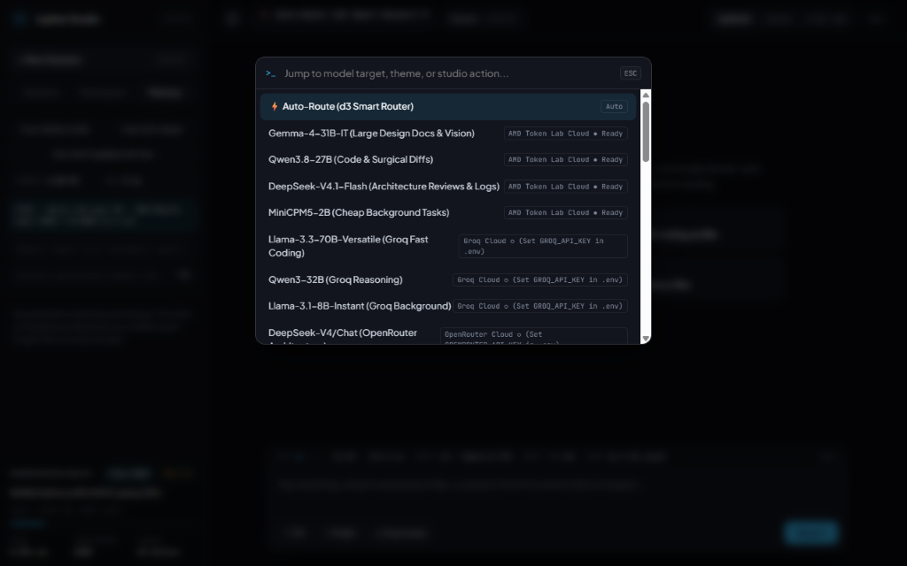
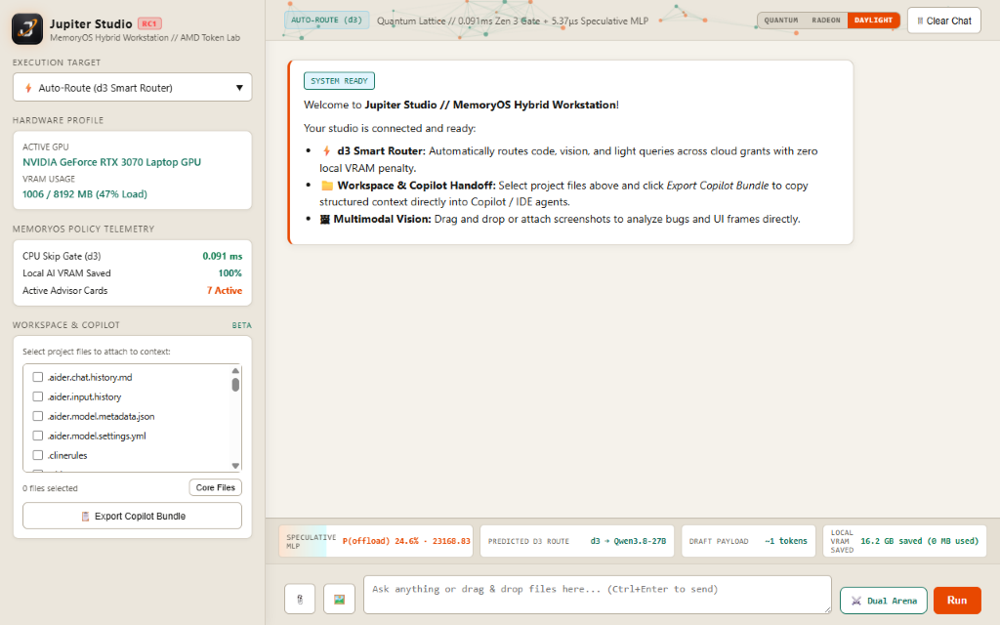
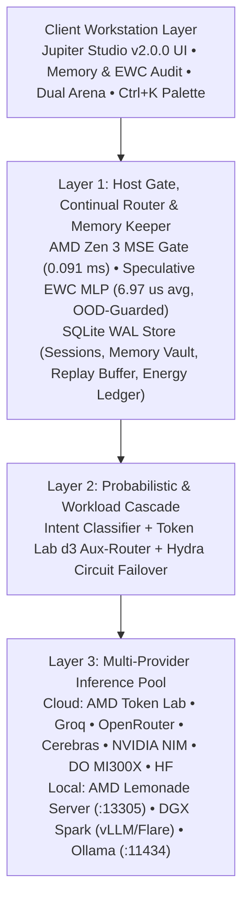

# MemoryOS // Jupiter Studio v2.0.0

> Hardware-aware hybrid AI workstation for local NPU/GPU runtimes, multi-cloud workload routing, VRAM reclamation, and continual non-forgetting memory.

[](https://github.com/JupiterIsland/memoryos/releases/latest)
[](https://github.com/JupiterIsland/memoryos/actions/workflow/status/JupiterIsland/memoryos/ci.yml)
[](https://github.com/JupiterIsland/memoryos/releases/latest)
[](PROOF_OF_RESULTS.md)
[](LICENSE)


**Jupiter Studio (`v2.0.0`)** pairs a single-process Python standard-library server and SQLite telemetry store with the **Precision Obsidian UI** — built for developers and PC gamers who need frontier coding, architecture review, and multimodal workflows on an 8 GB laptop GPU without VRAM thrashing, wasted idle GPU power, or session amnesia.

---

## What Is New in v2.0.0

* **Precision Obsidian UI Rebuild:** Matte dark layering, `Ctrl+K` Command Palette (`#target-selector` synced across 8 provider groups), custom dark-themed file selectors, and three switchable themes (**QUANTUM**, **RADEON**, and **ATARI B&W**).
* **Persistent SQLite Threads (`/api/sessions`):** Full multi-turn conversation storage with collapsible reasoning traces, instant reload, and cascade deletion inside `QuietAdvisorDB.sqlite` (WAL mode + `busy_timeout`).
* **Memory Keeper & Active VRAM Reclamation (`src/memoryos/memory_keeper.py`):**
  * **Free VRAM & RAM on Demand (`Free VRAM` button / CLI):** Safely queries localhost runners (`/api/ps`) to unload idle weights (`keep_alive: 0`) before a game or compile without killing user processes.
  * **Persistent Memory Vault:** Pin rules, hardware limits, and architectural context into SQLite (`continual_memory_facts`) for automatic cross-session recall.
  * **Energy Savings Ledger:** Transparent tracking of skipped redundant calls and offloaded GPU cycles (`0.15 Wh` per avoided heavy inference under a conservative `45 W` delta × `12 s` model).
* **Hardened Continual Router (`EWC + Experience Replay`):**
  * Incremental training of the local `4→8→1` `SpeculativeOffloadModel` using **Elastic Weight Consolidation (Fisher diagonal anchoring, `MAX_FISHER_VALUE = 25.0`) + Experience Replay**.
  * Includes SHA-256 checkpoint verification (`schema_version = 2`), out-of-distribution (`OOD`) abstention guards, provenance quarantine on replay episodes, and an interactive **`Run Anti-Forgetting Self-Test`** directly inside the Studio UI and CLI (`71/71` CI tests passing; `72/72` including end-to-end provider & Lemonade schema tests).
* **Expanded Multi-Cloud & Local Workload Routing:**
  * Added **Groq**, **OpenRouter**, and **Cerebras** alongside **AMD Token Lab**, **NVIDIA NIM**, **DigitalOcean MI300X**, **Hugging Face Router**, **AMD Lemonade Server** (`FastFlowLM` / `llama.cpp`), **DGX Spark (`vLLM`/`Flare`)**, and **Ollama**.
  * Fixed Lemonade Server endpoint normalization (`/api/v1/health` + `/models` schema detection) and WSL2 default-gateway discovery.

---

## Multi-Provider Workload Matrix

When `auto:d3` is active, Jupiter Studio routes workloads based on prompt intent, context footprint, and live provider readiness:

| Workload Type | Primary Route | Secondary / Cloud Failover | Local Offline Fallback |
| :--- | :--- | :--- | :--- |
| **Fast Coding & Diffs** | **Groq** (`llama-3.3-70b-versatile`) | Cerebras / Token Lab `Qwen3.8-27B` | Lemonade Server / Ollama |
| **Architecture Reviews** | **AMD Token Lab** (`DeepSeek-V4.1-Flash`) | OpenRouter `deepseek/deepseek-chat` | Lemonade Server / Ollama |
| **Large Design Docs & Vision** | **AMD Token Lab** (`Gemma-4-31B-IT`) | OpenRouter `gemma-3-27b-it` / NVIDIA NIM | Lemonade Vision / Ollama |
| **Cheap Background Tasks** | **AMD Token Lab** (`MiniCPM5-2B`) | Groq `llama-3.1-8b-instant` / Cerebras | Local light runner |

---

## Quick Start

### Option 1 — Standalone Release Executable (No Python Setup Required)

Download the pre-built archive for your platform from **[MemoryOS v2.0.0 Releases](https://github.com/JupiterIsland/memoryos/releases/latest)** (`SHA256SUMS.txt` verified):

* **Windows x64:** Extract `JupiterStudio-Windows-x64.zip` → run `JupiterStudio.exe --workspace "C:\path\to\repo"`
* **macOS (Apple Silicon):** `tar -xzf JupiterStudio-macOS-arm64.tar.gz` → `./JupiterStudio-macOS-arm64/JupiterStudio --workspace ~/projects/repo`
* **Linux x64:** `tar -xzf JupiterStudio-Linux-x64.tar.gz` → `./JupiterStudio-Linux-x64/JupiterStudio --workspace ~/projects/repo`

### Option 2 — Run From Source

```bash
git clone https://github.com/JupiterIsland/memoryos.git
cd memoryos
cp .env.example .env   # Add keys for providers you use (Token Lab, Groq, OpenRouter, Cerebras, etc.)
python3 -B apps/jupiter_studio.py
```

Open **[http://127.0.0.1:7860](http://127.0.0.1:7860)** in your browser. See **[HOW_TO_USE_JUPITER_STUDIO.md](HOW_TO_USE_JUPITER_STUDIO.md)** for configuration walkthroughs and WSL2 Lemonade networking notes.

### Memory Keeper Standalone CLI

```bash
PYTHONPATH=.:src python3 -B -m memoryos.memory_keeper status   # Live GPU VRAM/power, host RAM, vault summary
PYTHONPATH=.:src python3 -B -m memoryos.memory_keeper reclaim  # Safely unload idle Ollama weights & collect RAM
PYTHONPATH=.:src python3 -B -m memoryos.memory_keeper train    # Train EWC continual router & save signed checkpoint
PYTHONPATH=.:src python3 -B -m memoryos.memory_keeper audit    # Run Naive SGD vs EWC+Replay anti-forgetting audit
```

---

## Screenshots (`v2.0.0`)

| QUANTUM + Memory & Anti-Forgetting Audit | Ctrl+K Command Palette |
| :---: | :---: |
|  |  |

| AMD RADEON Crimson Theme | ATARI B&amp;W Monochrome Theme |
| :---: | :---: |
|  |  |

---

## Architecture



---

## Verified Benchmarks & Test Evidence

All telemetry and regression figures below are directly measured via our test suites ([`PROOF_OF_RESULTS.md`](PROOF_OF_RESULTS.md), [`tests/test_memory_keeper.py`](tests/test_memory_keeper.py), [`tests/run_gamer_hardware_tests.py`](tests/run_gamer_hardware_tests.py)).

| Verification / Benchmark | Scope & Condition | Observed Result |
| :--- | :--- | :--- |
| **CI Unit & Live HTTP Suite** | `PYTHONPATH=. python3 -B -W error::DeprecationWarning -m unittest ...` | **72 / 72 passed (`OK`)** |
| **Naive SGD vs EWC + Replay Retention** | Sequential Task A (Gaming) → Task B (Coding) → Task C (Multimodal) | Naive SGD dropped Task A **`100% → 0%`**; EWC + Replay retained **`100%`** (`ewc_task_a_after_abc = 1.0`) |
| **Speculative MLP Latency** | 500–1,000 pure-Python forward passes | **`5.73 – 6.97 μs` avg** (`<0.1%` of a `6.94 ms` 144 Hz frame budget) |
| **AMD Zen 3 CPU Skip Gate** | 200 iterations AVX2/FMA MSE frame delta | **`0.091 ms` avg** (`0.158 ms` p99) |
| **Offloaded GPU Idle Baseline** | RTX 3070 Laptop GPU (8 GB) via `nvidia-smi` during Studio offload | **`19.14 W` / `57.4 °C`** (`0 MB` local VRAM sacrificed to inference) |
| **Checkpoint Tamper & OOD Defense** | Mutated weight SHA-256 check; inputs outside `[-0.05, 1.25]` | Tampered checkpoints rejected (`ValueError`); OOD abstains to `digest` |

---

## Security & Privacy Controls

* **Localhost Binding & Strict Origin Enforcement:** Binds exclusively to `127.0.0.1`; rejects cross-origin `Origin` headers with `HTTP 403`.
* **Secret Upload Blocking:** `WorkspacePack` and browser file drop block `.env`, `.pem`, `.key`, `.p12`, `.pfx`, `.htpasswd`, SSH keys, and `credentials.json`.
* **Provenance Quarantine & Signed EWC Checkpoints:** External/untrusted episodes are filtered from EWC Fisher training; continual checkpoints verify `checksum_sha256`.
* **No Hidden Background Offload Surprises:** Placeholder API keys (`your-...-here`) fail closed safely to the next configured provider or local runtime.

---

## Documentation Index

* **[PROOF_OF_RESULTS.md](PROOF_OF_RESULTS.md)** — Production AMD Token Lab telemetry audit, energy avoidance math & v2.0.0 benchmarks
* **[HOW_TO_USE_JUPITER_STUDIO.md](HOW_TO_USE_JUPITER_STUDIO.md)** — Plain-English setup guide, WSL2 networking notes & honest scope limits
* **[ARCHITECTURE.md](ARCHITECTURE.md)** — System topology and database schema overview
* **[INSTALL.md](INSTALL.md)** — Installation and cross-platform packaging instructions

---

## License

MIT License — see [LICENSE](LICENSE) for full details. Founded and maintained independently by **Richard John Murray** ([`JupiterIsland`](https://github.com/JupiterIsland)).
