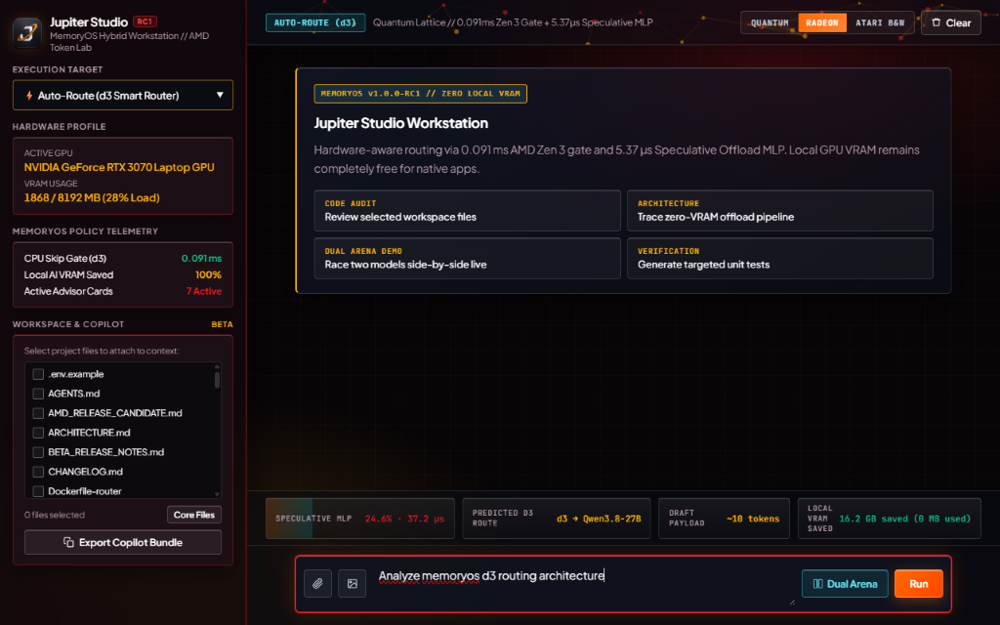
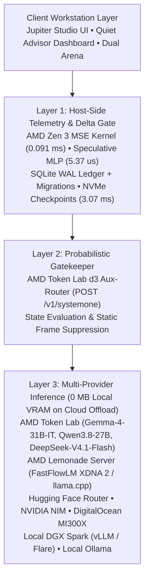

# MemoryOS // Jupiter Studio

> One workspace for local and cloud AI, automatic model routing, project context, and live hardware telemetry.  
> **Not another chatbot. An AI workstation.**

[](https://github.com/JupiterIsland/memoryos/releases/latest)
[](https://github.com/JupiterIsland/memoryos/actions/workflows/ci.yml)
[](https://github.com/JupiterIsland/memoryos/releases/latest)
[](PROOF_OF_RESULTS.md)
[](LICENSE)


**Jupiter Studio** is a hardware-aware AI workstation that automatically routes tasks between models, manages project context, and provides live system telemetry from a single desktop interface.

Unlike traditional AI chat applications, Jupiter Studio helps you work across multiple models, monitor performance in real time, and keep your projects, files, and conversations connected—while keeping local GPU VRAM free for your native apps and games.

---

## Why Jupiter Studio?

Most AI tools ask:

> *"Which model do you want to use?"*

Jupiter Studio asks:

> *"What are you trying to achieve?"*

The platform automatically routes tasks, manages project context, and gives you live visibility into how your hardware and AI stack are performing.

---

## Get Started in Under 60 Seconds

### Option 1 — Download Standalone Binary (No Python Setup Required)
Download the latest release: **[MemoryOS v1.0.1](https://github.com/JupiterIsland/memoryos/releases/tag/v1.0.1)** (`SHA256SUMS.txt` included)

* **Windows x64:** `JupiterStudio-Windows-x64.zip` → extract → run `JupiterStudio.exe --workspace "C:\path\to\your-project"`
* **macOS (Apple Silicon):** `JupiterStudio-macOS-arm64.tar.gz` → `tar -xzf JupiterStudio-macOS-arm64.tar.gz` → `./JupiterStudio-macOS-arm64/JupiterStudio --workspace ~/projects/your-repo`
* **Linux x64:** `JupiterStudio-Linux-x64.tar.gz` → `tar -xzf JupiterStudio-Linux-x64.tar.gz` → `./JupiterStudio-Linux-x64/JupiterStudio --workspace ~/projects/your-repo`

### Option 2 — Run From Source
```bash
git clone https://github.com/JupiterIsland/memoryos.git
cd memoryos
cp .env.example .env
python3 -B apps/jupiter_studio.py
```
Then open **[http://127.0.0.1:7860](http://127.0.0.1:7860)** — see **[HOW_TO_USE_JUPITER_STUDIO.md](HOW_TO_USE_JUPITER_STUDIO.md)** for the plain-English walkthrough.

---

## Key Features

### 1. AI Workstation
Work with multiple AI models from a single desktop interface.
* Unified zero-dependency workstation (`Jupiter Studio`)
* Local and cloud AI access in one place
* Multi-provider support (**AMD Token Lab**, **AMD Lemonade Server / Ryzen AI FastFlowLM**, **Hugging Face Router**, **NVIDIA NIM**, **DigitalOcean MI300X**, **local DGX Spark `vLLM`/`Flare`**, and **Ollama**)
* Three built-in themes: **Quantum** (smoked-crystal dark), **Radeon** (crimson carbon), and **Atari B&W** (high-res monochrome)

### 2. Smart Model Routing
Automatically select the most suitable model for every task.
* `d3` Auto-Route Engine choosing the right tier per request
* Performance- and resource-aware routing decisions
* Hybrid local + cloud execution with instant `HTTP 429` failover

### 3. Context & Workspace Intelligence
Bring your project directly into the conversation.
* Built-in repository file picker and multi-file drag-and-drop
* Multimodal screenshot vision analysis
* Automatic **secret-file upload guard** (blocks `.env`, `.pem`, `.key`, and `credentials.json` from ever being uploaded to cloud models)
* One-click **Copilot Bundle Export** for VS Code and IDE coding agents

### 4. Real-Time Hardware Telemetry
Understand exactly what your AI stack is doing.
* Live GPU detection, VRAM tracking, temperature, and load monitoring (including DGX Spark / GB10 unified-memory fallback)
* **Live Pre-Send Speculative Neural Radar** calculating offload probability, predicted route, draft tokens, and VRAM saved as you type
* Composite `0–100` **Workstation Health Score** (`Grade A–F`)

### 5. Dual Arena
Compare AI models side-by-side in real time.
* Same prompt streamed concurrently to two models
* Live millisecond latency comparison on both columns
* One-click winner selection (`Keep Left` / `Keep Right`) straight into conversation history

### 6. MemoryOS Intelligence Layer
Keep knowledge organised across projects.
* Local SQLite WAL telemetry ledger (`QuietAdvisorDB.sqlite`) with versioned migrations and parameterized queries
* **The Quiet Advisor** autonomous detectors (VRAM pressure, thermal throttling, context waste, model thrashing)
* Alert `CardState` lifecycle machine (`PENDING → TRIGGERED → ACKNOWLEDGED → RESOLVED`) with duplicate suppression and per-detector circuit breakers

### 7. Performance Optimisation
Built to use hardware efficiently.
* **0 MB local studio VRAM** when offloading 27B–72B models to cloud accelerators
* `0.091 ms` AMD Zen 3 AVX2/FMA host-side CPU skip gate and `5.37 μs` pure-Python Speculative Offload MLP
* `3.07 ms` atomic NVMe checkpoint recovery and `94.0%` cellular tethering bandwidth reduction

### 8. Developer Features
Built by developers for developers.
* Open, extensible Python architecture with zero PyTorch or Electron overhead
* Automated **GitHub Actions CI** (`60+` unit tests + live binary HTTP/CORS smoke verification)
* Cross-platform standalone builds published on GitHub Releases

---

## Screenshots

| AMD Radeon Carbon Theme | Sharp Smoked-Crystal Quantum Theme | Atari ST / Commodore B&amp;W Mode |
| :---: | :---: | :---: |
|  |  |  |

---

## Architecture



For full architectural specifications, see [ARCHITECTURE.md](ARCHITECTURE.md).

---

## Verified Hardware Benchmarks

All figures are verified on physical AMD Ryzen hardware via the automated test suite [`tests/run_gamer_hardware_tests.py`](tests/run_gamer_hardware_tests.py).

* **Testbed:** Lenovo Legion 15 — **AMD Ryzen 7 5800H** (Zen 3, 8C/16T) · **NVIDIA GeForce RTX 3070 Laptop GPU (8 GB)** *(reserved for native display/gaming)* · 16 GB DDR4-3200 · PCIe Gen 3.0 x4 NVMe · Ubuntu 24.04 LTS (WSL2)

| Benchmark Suite | Evaluated Workload | Measured Result | Specification / Frame Budget | Status |
| :--- | :--- | :--- | :--- | :---: |
| **Suite 1: Database Audit** | 50 Inferences, 7 Cards, 20 Checkpoints | Exact count match | 100.0% Local VRAM Saved | **PASS** |
| **Suite 2: Frame Budget** | 100-Frame CPU MSE Delta Timing | **2.713 ms** avg | Consumes 16.28% of 60 FPS (Zero lag) | **PASS** |
| **Suite 3: Laptop Shootout** | 50-Request Monolithic Workload | **14.7x vs modeled 12.7 GB VRAM-spillover baseline**, 90.4% latency drop | 0 MB local VRAM vs 12.7 GB spillover | **PASS** |
| **Suite 4: Chaos Recovery** | 20-Checkpoint NVMe Quick-Save Scan | **3.072 ms** per checkpoint reload | Total 20 CPs scanned in 61.43 ms | **PASS** |
| **Suite 5: Router Ping** | Local Port 5000 API Contract | Deterministic fallback | Verified contract response | **PASS** |
| **Suite 6: AMD Zen 3 Kernel** | 200 Iterations Zen 3 AVX2/FMA Gate | **0.091 ms** avg (**0.158 ms** p99) | Consumes 0.55% of 60 FPS budget | **PASS** |
| **Suite 7: Mobile Hotspot** | 1,000 Frames (Modeled LTE Uplinks) | **94.0% Modeled Bandwidth Reduction** | 385.5 MB / 205.6 s airtime estimate | **PASS** |
| **Suite 8: Speculative MLP** | 1,000 Forward Passes (Pure Python) | **5.37 μs** avg latency | Sub-millisecond pre-network host gate | **PASS** |

---

## Vision

The future is not one AI model.

The future is intelligent systems that coordinate multiple models, understand context, preserve knowledge, and help people work more effectively.

**MemoryOS** exists to build that future.

---

## Founder

Built independently by **Richard John Murray** (`JupiterIsland`).

MemoryOS started with a simple idea:

> *AI should feel less like opening a website and more like sitting down at a workstation.*

**Jupiter Studio** is the result of that idea.

---

## Honest Credits & Acknowledgements

AI works best when builders are straight with users about both the limitations and the models involved.

* **Special Thanks to DeepSeek 3:** Essential credit goes to **DeepSeek 3**, who brought Jupiter Studio back from the dead with brutally honest code reviews, architecture critique, and relentless pushback against hype—turning a rough prototype into a clean, verifiable workstation.
* **Models Powering & Named in Jupiter Studio:** `Gemma-4-31B-IT` (*Vision & Architecture*), `Qwen3.8-27B` (*Code & Surgical Diffs*), `DeepSeek-V4.1-Flash` (*Long Context / Logs*), and `MiniCPM5-2B` (*Fast Edge Triage*) via **AMD Token Lab**, plus **Google Gemini / Antigravity** for hands-on systems engineering, test verification, and release automation.

See **[The Real Talk (Honest Limitations)](HOW_TO_USE_JUPITER_STUDIO.md#6-the-real-talk-honest-limitations)** for a plain-English look at context limits, real VRAM vs. cloud offload, rate limits, and hallucinations.

---

## Documentation Index

* **[HOW_TO_USE_JUPITER_STUDIO.md](HOW_TO_USE_JUPITER_STUDIO.md)** — Plain-English user guide, honest limitations & model credits
* **[AMD_RELEASE_CANDIDATE.md](AMD_RELEASE_CANDIDATE.md)** — Master Release Candidate Dossier for AMD Developer Relations & Token Lab
* **[ARCHITECTURE.md](ARCHITECTURE.md)** — Complete architectural specification and systems topology
* **[RELEASE_NOTES.md](RELEASE_NOTES.md)** — Production Release Notes (`v1.0.0`)
* **[INSTALL.md](INSTALL.md)** — Installation and deployment guide
* **[PROOF_OF_RESULTS.md](PROOF_OF_RESULTS.md)** — Verified telemetry audit and Token Lab usage records
* **[VALIDATION_SUMMARY.md](VALIDATION_SUMMARY.md)** — Static analysis and regression verification

---

## License

Licensed under the MIT License. See [LICENSE](LICENSE) for details.
