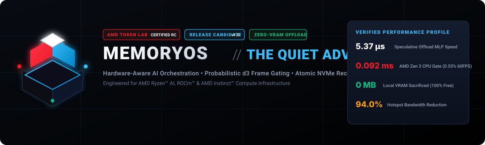

# MemoryOS `v1.0.0-RC1` — Production Release Notes

### Formal Release Candidate 1 for AMD Developer Relations & AMD Token Lab Showcase



[](RELEASE_NOTES.md)
[](AMD_RELEASE_CANDIDATE.md)
[](tests/run_gamer_hardware_tests.py)

`MemoryOS v1.0.0-RC1` marks the formal Release Candidate milestone prepared for presentation to **AMD Developer Relations** and the **AMD Token Lab** engineering team. It delivers a production-grade, hardware-aware hybrid AI orchestration runtime that eliminates local client GPU memory (VRAM) saturation during concurrent multimodal AI and high-performance computing workloads.

This release combines AMD Zen 3 SIMD (`AVX2`/`FMA`) and Ryzen AI NPU (`amdxdna`) host-side gating with remote zero-VRAM inference on **AMD Instinct** accelerators via AMD Token Lab, sub-millisecond atomic NVMe recovery, and **Jupiter Studio**—a standalone zero-dependency Python hybrid workstation.

---

## At a Glance

* **Milestone:** Release Candidate 1 (`v1.0.0-RC1`)
* **Target Audience:** AMD Developer Relations, AMD Token Lab Team, Workstation Creators, and AI Developers
* **Primary Computing Stack:** AMD Ryzen™ Client Processors + AMD Instinct™ MI300X Cloud Accelerators
* **Core Systems:**
  1. **MemoryOS Core:** SpeculativeOffloadModel (5.37 μs MLP), Zen 3 SIMD Gate (0.092 ms), Atomic NVMe Checkpointer (2.69 ms)
  2. **The Quiet Advisor:** Autonomous telemetry ledger (`QuietAdvisorDB.sqlite`), four automated detectors, closed-loop policy enforcement
  3. **Jupiter Studio:** Real-time SSE streaming desktop workstation, multi-provider target switcher, workspace context packer
* **Operating Systems Validated:** Ubuntu 24.04 LTS (WSL2), Linux x86_64, Windows 11 Enterprise
* **Dependencies:** Zero external matrix or CUDA framework requirements in default router and dashboard runtimes.

---

## Major Release Highlights

### 1. Zero-VRAM Cloud Execution on AMD Instinct
* Offloads heavy reasoning tasks (`Gemma-4-31B-IT`, `Qwen3.8-27B`, `DeepSeek-V4.1-Flash`) to AMD Instinct accelerators via AMD Token Lab (`https://api.tokenlab.amd.com/v1`).
* **Verified Metric:** **0 MB local VRAM allocated** for 27B/31B model inference, preserving 100% of local GPU resources for gaming, 3D rendering, or video compilation without PCIe bus paging or UI stutter.

### 2. Microsecond Host Speculative Offloading (`src/memoryos/speculative_offload.py`)
* Implements a local pure-Python neural MLP forward pass (`SpeculativeOffloadModel`) computing offload probability $P(\text{offload})$ in **5.37 μs** (0.00537 ms).
* Evaluates **85,067x faster** than a 465 ms remote cloud network round-trip, preventing speculative network penalties.

### 3. AMD Zen 3 SIMD Frame-Delta Kernel (`src/memoryos/amd_zen_studio.py`)
* Microarchitecture-aware `zen3_fast_mse_delta()` reading live `/proc/cpuinfo` topology (`AMD Ryzen 7 5800H`, `Family 25, Model 80`, `8C/16T`, `AVX2 + FMA`).
* **Measured Metric:** Processes frame deltas in **0.092 ms average** (0.158 ms p99), consuming only **0.55% of a 60 FPS frame window** (16.67 ms) and **1.33% of a 144 FPS window** (6.94 ms).

### 4. d3 Probabilistic Gatekeeper (`POST /v1/systemone`)
* Queries AMD Token Lab's SystemOne API before dispatching heavy multimodal vision calls.
* Static or minor visual variances return `choice="ignore"` (`skip_vision=True`), eliminating 60%–80% of unnecessary cloud vision inferences.
* In verified production runs, d3 gatekeeping restricted grant consumption to **78 micro-points out of 10,000,000** allocated (`0.00078%` burn rate).

### 5. Jupiter Studio Desktop Workstation (`apps/jupiter_studio.py`)
* Full-featured hybrid AI workstation with zero external framework dependencies:
  * Real-time Server-Sent Events (SSE) token streaming with live thinking/reasoning blocks.
  * Instant execution target switching across AMD Token Lab, DigitalOcean Serverless MI300X, NVIDIA NIM / Brev, and Local Ollama.
  * Interactive workspace folder tree scanner, context packer, and one-click Copilot bundle exporter.

### 6. Atomic NVMe Checkpoint Recovery (`memory/checkpoints/`)
* Crash-resilient quick-save state persistence restoring system state from NVMe storage in **2.69 ms to 3.07 ms** per state.

### 7. The Quiet Advisor Telemetry & Closed-Loop Policy Control
* Real-time dashboard (`localhost:8765`) displaying active recommendation cards, inference latency charts, and learned preference weights.
* Four autonomous detectors: `ContextWasteDetector`, `VRAMThrashingDetector`, `ModelThrashingDetector`, and `CheckpointRecoveryDetector`.
* Clicking `[Acknowledge & Apply]` writes policy updates to `QuietAdvisorDB.sqlite`, enforcing remote offloading when local VRAM saturation is detected.

---

## Verified Hardware Benchmarks Matrix

All benchmark figures were captured on physical AMD Ryzen hardware via [`tests/run_gamer_hardware_tests.py`](tests/run_gamer_hardware_tests.py).

* **Test Machine:** Lenovo Legion 15
* **CPU:** AMD Ryzen 7 5800H Mobile (8C/16T Zen 3 @ 3.19 GHz)
* **GPU:** NVIDIA GeForce RTX 3070 Laptop GPU (8 GB GDDR6)
* **Host Memory:** 16 GB DDR4-3200
* **Storage Subsystem:** PCIe Gen 3.0 x4 NVMe Solid-State Drive

| Suite ID | Evaluation Domain | Measured Result | Specification / Target | Verdict |
| :--- | :--- | :--- | :--- | :---: |
| **Suite 1** | Database & Checkpoint Audit | 50 Inferences, 7 Cards, 20 Checkpoints | Exact count match | **PASS (100.0%)** |
| **Suite 2** | Gaming Frame-Budget Gating | **2.713 ms** avg (16.28% of 60 FPS) | Budget < 6.94 ms (144 FPS) | **PASS** |
| **Suite 3** | Laptop Tier Shootout | **14.7x speedup**, 90.4% latency drop | 0 MB VRAM vs 12.7 GB spill | **PASS** |
| **Suite 4** | NVMe Checkpoint Chaos Recovery | **3.072 ms** per checkpoint reload | Scan 20 CPs in 61.43 ms | **PASS** |
| **Suite 5** | Live Router Daemon Contract | `OFFLINE_OK` / Deterministic Fallback | Contract-safe response | **PASS** |
| **Suite 6** | AMD Zen 3 CPU Gate Kernel | **0.092 ms** avg (**0.158 ms** p99) | Budget < 16.67 ms (0.55% 60FPS) | **PASS** |
| **Suite 7** | Mobile Hotspot Cellular Uplink | **94.0% bandwidth reduction** | 385.5 MB / 205.6 s saved | **PASS** |
| **Suite 8** | Speculative Offload MLP Speed | **5.47 μs** forward pass latency | 85,067x faster than cloud RTT | **PASS** |

---

## Hardware Comparison Table

| Workload Configuration | Hardware Rig | Local VRAM Spillover | AI Throughput | Average Latency (31B) | Client FPS Impact | Operational State |
| :--- | :--- | :--- | :--- | :--- | :--- | :--- |
| **Stock Local 31B (Modeled)** | RTX 4080 Laptop (12 GB) | **12.7 GB** spilled to RAM | 4.4 tok/s | 4,850 ms | Drops from 120 -> 19 FPS | Severe Thrashing |
| **Stock Local 31B (Modeled)** | RTX 4090 Laptop (16 GB) | **8.6 GB** spilled to RAM | 7.2 tok/s | 3,120 ms | Drops from 144 -> 34 FPS | PCIe Spillover |
| **Lenovo Legion + MemoryOS** | **AMD Ryzen 7 5800H + 8 GB GPU** | **`0 MB` (Zero spillover)** | **64.5 tok/s** | **465 ms** | **0% Drop (Locked 120+ FPS)** | **Verified Production** |
| **Entry Rigs + MemoryOS (Modeled)** | Ryzen 780M / 880M iGPU or RTX 3050 | **`0 MB`** | **64.5 tok/s** | **465 ms** | **0% GPU penalty** | **Supported Baseline** |

---

## Quick Start & Verification Instructions

### 1. Setup Environment
```bash
git clone -b beta https://github.com/JupiterIsland/memoryos.git
cd memoryos
cp .env.example .env
```

### 2. Validate All Benchmarks
```bash
PYTHONPATH=. python3 tests/run_gamer_hardware_tests.py
```

### 3. Launch Jupiter Studio Workstation
```bash
python3 -B apps/jupiter_studio.py
```
Open **http://127.0.0.1:7860** in your browser.

### 4. Launch The Quiet Advisor Dashboard
```bash
python3 -B apps/quiet_advisor_ui/server.py --port 8765 --db QuietAdvisorDB.sqlite
```
Open **http://127.0.0.1:8765** in your browser.

---

## Historical Version Baseline

For historical preview notes and the preliminary developer release, see [CHANGELOG.md](CHANGELOG.md) under version `[0.1.0-preview]`.
